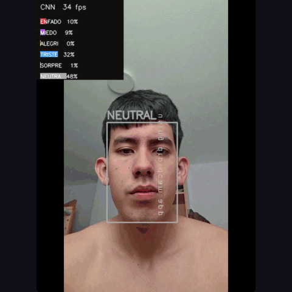
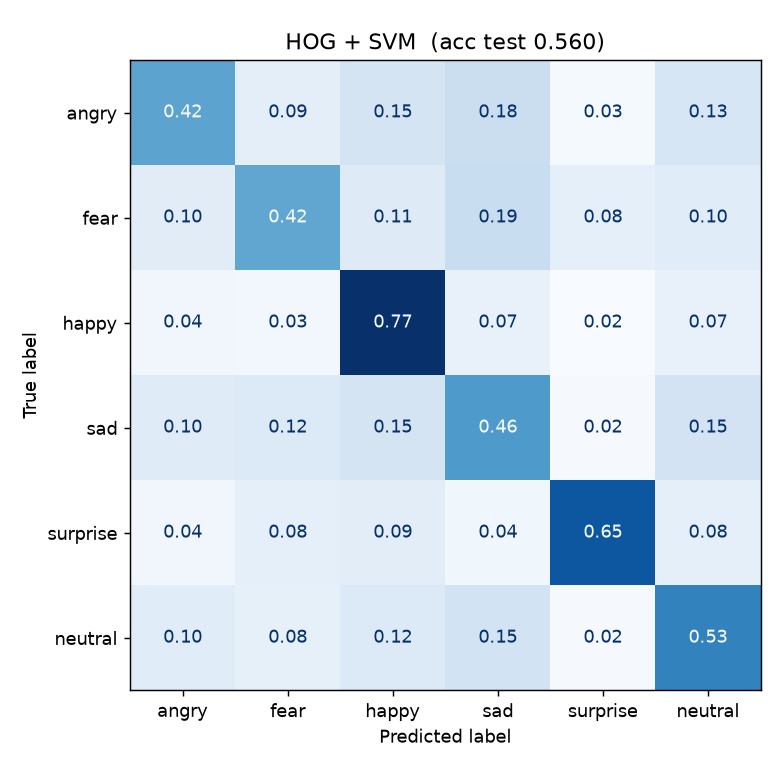
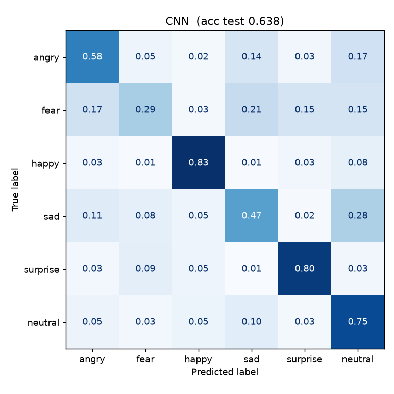
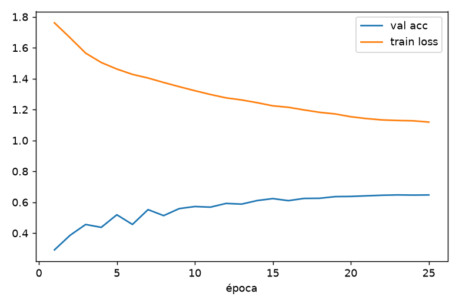

# Práctica 5. Biometría: detección y caracterización de caras

## Demo (≤ 30 s)



*Momentos seleccionados: Espejo de emociones (CNN entrenada sobre FER2013) y, a continuación, Tetris facial controlado con la cara (a 1,5× de velocidad).*

Dos prototipos que **reaccionan a información extraída del rostro**. Ambos usan MediaPipe Face Landmarker
(478 landmarks + 52 blendshapes) para detectar la cara y sus elementos.

| | Prototipo 1: *Espejo de emociones* | Prototipo 2: *Tetris facial* |
|---|---|---|
| Archivo | [reacciones_emocion.py](reacciones_emocion.py) | [tetris_cara.py](tetris_cara.py) |
| Modelo | **Entrenado por nosotros** (CNN y HOG+SVM sobre FER2013) | Reglas sobre landmarks/blendshapes con calibración por usuario |
| Entrada del rostro | Recorte de la cara a 48×48 en gris + landmarks | Inclinación de cabeza, parpadeo, cejas |
| Reacción | Efectos visuales anclados a los landmarks | Control de un juego (Tetris) manos libres |

---

## 1. Escenarios de aplicación

**Prototipo 1: Espejo de emociones (ocio / comunicación aumentada).**
Un espejo interactivo para videollamadas, streaming o instalaciones artísticas: el sistema reconoce la emoción
del usuario y la *amplifica* con efectos (confeti al sonreír, lágrimas al estar triste, vapor y tinte rojo
al enfadarse, etc.). Los efectos se anclan a los landmarks (ojos, frente, tamaño de la cara), de modo que siguen
al rostro. El mismo clasificador podría usarse para medir la reacción de una audiencia.

**Prototipo 2: Tetris facial (accesibilidad y juego manos libres).**
Un videojuego que se controla solo con la cara, pensado para personas que no pueden usar teclado o mando.
Sustituye los botones por gestos naturales que cualquiera puede hacer y que son fáciles de calibrar por usuario.

---

## 2. Prototipo 1: Espejo de emociones

### Pipeline
1. **Cámara** (DroidCam, imagen rotada y en modo espejo).
2. **MediaPipe Face Landmarker** devuelve los 478 puntos de la cara.
3. **Recorte**: caja cuadrada de la cara (frente a barbilla) desde los landmarks, a **48×48 en gris**, el mismo
   formato que FER2013.
4. **Clasificador entrenado por nosotros** (CNN o HOG+SVM; tecla `M` para alternar) → probabilidades de 6 emociones,
   suavizadas con una media móvil exponencial para evitar parpadeos de la etiqueta.
5. **Efecto** según la emoción dominante, anclado a landmarks:

| Emoción | Efecto | Landmarks usados |
|---|---|---|
| Alegría | Confeti | (pantalla completa) |
| Tristeza | Lágrimas azules + tinte frío | Centros de los iris (468, 473) |
| Enfado | Tinte rojo + vapor sobre la cabeza | Frente (10), ancho de cara (234, 454) |
| Sorpresa | Ojos de dibujo animado que "se agrandan" | Iris, ancho de cara |
| Miedo | Viñeta oscura + gotas de sudor | Frente, ancho de cara |
| Neutral | Sin efecto | |

### Dataset: FER2013
- Copia pública de Hugging Face [`abhilash88/fer2013-enhanced`](https://huggingface.co/datasets/abhilash88/fer2013-enhanced)
  (FER2013 original: imágenes en gris de 48×48, 7 emociones, recogidas de la web).
- Particiones usadas: **25.117 entrenamiento / 5.380 validación / 5.390 test**.
- **Decisión sobre el dataset:** se **descarta la clase *disgust*** porque solo tiene 382 muestras de entrenamiento
  (1,5 %), insuficiente para aprenderla, y se trabaja con **6 clases**: enfado, miedo, alegría, tristeza, sorpresa
  y neutral. Tras descartarla quedan 24.735 imágenes de entrenamiento (alegría 6.292, neutral 4.338, tristeza 4.253,
  miedo 3.584, enfado 3.467, sorpresa 2.801).
- El desbalance restante se compensa con **pesos por clase** en la función de pérdida (CNN) y
  `class_weight="balanced"` (SVM).
- Limitación conocida: FER2013 tiene etiquetas ruidosas y caras de baja resolución, por lo que el techo de
  precisión es bajo (el acuerdo entre anotadores humanos ronda el 65 %).

### Modelos entrenados

**A) CNN** ([entrenar_cnn.py](entrenar_cnn.py), definición en [emociones_comun.py](emociones_comun.py)).
- 3 bloques (2 conv 3×3 + BatchNorm + ReLU + MaxPool + Dropout 0,25) con 32-64-128 filtros, y clasificador denso
  256 → 6 con Dropout 0,5. **1.468.774 parámetros**.
- AdamW (lr máx. 2e-3, *OneCycle*), 25 épocas, lote 128, *label smoothing* 0,05, pérdida ponderada por clase.
- **Aumento de datos** en cada lote: giro horizontal, rotación ±12°, escala 0,9–1,1, traslación ±8 %.
- Se conserva la época con mejor precisión de **validación**; el test se evalúa una sola vez al final.
- Entrenada en una **NVIDIA RTX 3050**: 174 s en total (≈7 s/época; en CPU eran ≈125 s/época).

**B) HOG + SVM (modelo clásico)** ([entrenar_svm.py](entrenar_svm.py)).
- HOG (9 orientaciones, celdas 6×6, bloques 2×2): 1.764 características por imagen.
- SVM con kernel RBF (C = 5, `gamma="scale"`, pesos de clase balanceados).

### Resultados (conjunto de test, 5.307 imágenes)

| | HOG + SVM (clásico) | CNN (red neuronal) |
|---|---|---|
| **Precisión (test)** | 56,0 % | **63,8 %** |
| **F1 macro (test)** | 0,545 | **0,610** |
| Precisión (validación) | 55,2 % | 64,7 % |
| Tiempo de entrenamiento | 2.045 s (≈34 min, CPU) | **174 s** (≈3 min, GPU RTX 3050) |
| Inferencia por imagen | ≈30 ms (solo SVM, CPU) + ≈1,3 ms de HOG | **2,4 ms** (CPU) |
| Parámetros / tamaño | Vectores soporte del SVM (1.764 características) | 1,47 M parámetros |
| Facilidad de uso | Sin GPU, pocos hiperparámetros | Necesita elegir arquitectura, aumento de datos y GPU para entrenar cómodo |

La CNN gana en precisión (+7,8 puntos), en velocidad de inferencia (≈13 veces más rápida) y en tiempo de
entrenamiento (con GPU). El SVM clásico, en cambio, no necesita GPU y su configuración es más sencilla. Resultados
por clase del SVM: alegría F1 0,72, sorpresa 0,69, neutral 0,52, enfado 0,45, miedo 0,45 y tristeza 0,44. Es
interesante que el SVM **supera a la CNN en el miedo** (F1 0,45 frente a 0,38, recall 42 % frente a 29 %), mientras que
la CNN gana en el resto de clases. Matriz de confusión del SVM: 

*Nota sobre la comparación de tiempos:* el entrenamiento del SVM se hizo en CPU y el de la CNN en GPU, y el SVM
corrió a la vez que otros procesos (CNN en CPU durante parte del tiempo), por lo que su tiempo es orientativo.

**Resultados por clase de la CNN**

| Emoción | Precisión | Recall | F1 |
|---|---|---|---|
| Alegría | 0,880 | 0,835 | 0,857 |
| Sorpresa | 0,681 | 0,797 | 0,735 |
| Neutral | 0,527 | 0,747 | 0,618 |
| Enfado | 0,562 | 0,579 | 0,570 |
| Tristeza | 0,534 | 0,472 | 0,501 |
| Miedo | 0,526 | 0,294 | 0,377 |

Matriz de confusión y curvas:  

### Discusión
- La **alegría** y la **sorpresa** se reconocen bien: son expresiones con rasgos muy marcados (sonrisa, boca y ojos
  abiertos). La **alegría** es además la clase con más ejemplos.
- El **miedo** es la peor clase (recall 29 %) y su error está muy repartido: el 21 % se predice como tristeza, el 17 %
  como enfado, el 15 % como sorpresa y otro 15 % como neutral. Comparte rasgos con todas ellas (ojos abiertos, cejas
  elevadas, tensión facial) y tiene etiquetas muy ruidosas en FER2013. La **tristeza** se confunde sobre todo con
  *neutral* (28 %).
- Predice *neutral* con facilidad (recall 75 %, precisión 53 %), lo que hace que parte de las demás emociones se
  "absorban" en esa clase.
- En el uso real hay un **cambio de dominio**: FER2013 son imágenes de baja resolución recogidas de la web; nuestra
  cámara es otra. El recorte con landmarks y el aumento de datos ayudan, pero las expresiones deben ser claras. Con
  expresiones exageradas el prototipo funciona de forma fluida.
- Mejoras posibles: más datos de otros datasets (AffectNet, RAF-DB), preentrenamiento, y fusionar clases parecidas.

---

## 3. Prototipo 2: Tetris facial

Tetris completo (rotación, líneas, niveles, puntuación, pieza fantasma) controlado solo con la cara:

| Gesto | Acción | Señal usada |
|---|---|---|
| Inclinar la cabeza | Mover la pieza a izquierda o derecha | Ángulo de la línea entre las comisuras externas de los ojos (landmarks 33 y 263) |
| Parpadeo deliberado | Rotar la pieza | Blendshapes `eyeBlinkLeft/Right` |
| Levantar las cejas | Caída rápida | Blendshapes `browInnerUp`, `browOuterUpLeft/Right` |

Decisiones de diseño para la **robustez**:
- **Calibración por usuario** al arrancar (3 pasos de 3 s: cara neutra, ojos cerrados, cejas arriba). Los umbrales se
  calculan a partir de lo medido en cada persona y no con valores fijos (tecla `C` para recalibrar).
- **Movimiento con control fino**: un golpe rápido de cabeza mueve exactamente 1 columna. Una inclinación suave
  mantenida avanza 1 columna cada 0,5 s, y inclinar más acelera hasta 1 columna cada 0,1 s. Hay **histéresis**
  (se activa a 8° y se suelta a 5°) y un **filtro de suavizado** sobre el ángulo para evitar pasos por temblor.
- **Parpadeo** con tiempo mínimo y enfriamiento entre rotaciones, para no confundirlo con parpadeos involuntarios.
- **Cámara**: reintenta abrir la cámara, la reabre si se corta, y rota la imagen (DroidCam envía el vídeo girado).
- Panel con barras en tiempo real y el umbral de cada gesto, útil para depurar y para explicar el funcionamiento.

---

## 4. Cómo ejecutarlo

```powershell
pip install mediapipe opencv-contrib-python==4.12.0.88 pygame numpy scikit-learn scikit-image datasets joblib
pip install torch   # con CUDA para entrenar más rápido (opcional; la demo funciona en CPU)

python tetris_cara.py            # Prototipo 2 (descarga face_landmarker.task la primera vez)
python reacciones_emocion.py     # Prototipo 1 (usa modelos/cnn.pt y modelos/svm_hog.joblib)
```
Reentrenar los modelos:
```powershell
python preparar_datos.py   # descarga FER2013 y crea datos/fer2013.npz
python entrenar_svm.py     # HOG + SVM
python entrenar_cnn.py     # CNN
```
Variables útiles: `CAMERA_INDEX` (índice de cámara) y `CAMERA_ROTATE` (`cw`, `ccw`, `180`, `none`).
`python probe_camara.py` diagnostica qué cámaras entregan imagen.

## 5. Estructura

```
reacciones_emocion.py   Prototipo 1 (demo en directo)
tetris_cara.py          Prototipo 2 (Tetris facial)
emociones_comun.py      CNN y extracción HOG compartidas por entrenamiento y demo
preparar_datos.py       FER2013 -> datos/fer2013.npz
entrenar_svm.py         Entrenamiento HOG + SVM
entrenar_cnn.py         Entrenamiento CNN
probe_camara.py         Diagnóstico de cámara
modelos/                Modelos entrenados
resultados/             Métricas (.json), matrices de confusión y curvas (.png)
```

## Referencias
- Goodfellow et al., *Challenges in Representation Learning: A report on three machine learning contests* (FER2013), 2013.
- Dalal y Triggs, *Histograms of Oriented Gradients for Human Detection*, CVPR 2005.
- MediaPipe Face Landmarker: https://ai.google.dev/edge/mediapipe/solutions/vision/face_landmarker

---
**Nota:** el modelo `modelos/svm_hog.joblib` (310 MB) no está en el repositorio por superar el límite de GitHub (100 MB). Se regenera con `python preparar_datos.py` y `python entrenar_svm.py` (unos 35 min en CPU). Sin él, la demo funciona con la CNN (la tecla `M` no cambia de modelo); las métricas del SVM están en `resultados/`.
